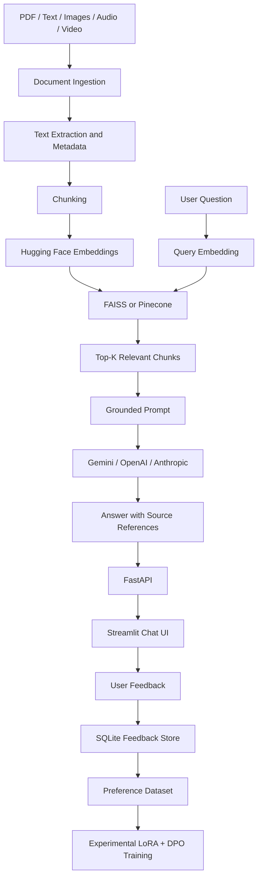

# Multimodal Knowledge Copilot
### Retrieval-Augmented Generation (RAG) · Embedding Fine-Tuning · Preference Optimization

A document-grounded Generative AI assistant designed to answer questions over private or domain-specific knowledge sources. It combines multimodal document ingestion, semantic retrieval, large language models, source citations, evaluation workflows, and user feedback in one application.

Instead of relying only on an LLM's pretrained knowledge, the copilot retrieves relevant passages from an indexed document collection and uses them to generate answers grounded in the available evidence.

**Core capabilities**
- Multimodal ingestion for PDFs, text files, images, audio, and video.
- Retrieval-Augmented Generation using LangChain and vector search.
- Hugging Face sentence-transformer embeddings with an embedding fine-tuning workflow.
- Configurable vector storage using FAISS or Pinecone.
- Source-grounded answers with document references and available page or timestamp metadata.
- Pluggable LLM providers: Google Gemini, OpenAI, and Anthropic.
- Retrieval and answer-quality evaluation workflows.
- A feedback collection workflow with an experimental LoRA and Direct Preference Optimization (DPO) pipeline.
- FastAPI backend and Streamlit chat interface.
- Docker packaging, automated checks, and tests.

> **Implementation status:** This repository includes application code and experimental workflows. Fine-tuning gains, provider comparisons, preference-optimization improvements, and deployment should be considered verified only after the corresponding commands have been run successfully and their results recorded.

---

## Table of Contents

- [Problem Statement](#problem-statement)
- [Architecture](#architecture)
- [Features](#features)
- [Technology Stack](#technology-stack)
- [Project Structure](#project-structure)
- [How RAG Works](#how-rag-works)
- [Getting Started](#getting-started)
- [Configuration](#configuration)
- [Running the Application](#running-the-application)
- [Evaluation and Experiments](#evaluation-and-experiments)
- [Feedback and Preference Optimization](#feedback-and-preference-optimization)
- [Docker and Deployment](#docker-and-deployment)
- [Testing and Code Quality](#testing-and-code-quality)
- [Security Considerations](#security-considerations)
- [Limitations](#limitations)
- [Future Improvements](#future-improvements)

---

## Problem Statement

General-purpose LLMs can produce plausible but incorrect answers when asked about information that is not present in their pretrained knowledge. This is particularly problematic for company policies, technical documentation, product manuals, research papers, and other domain-specific information.

The Multimodal Knowledge Copilot addresses this problem by retrieving relevant evidence from user-provided documents before generating a response.

The intended workflow is:

1. Upload or index a collection of documents.
2. Extract text and associated source metadata.
3. Split the extracted content into searchable chunks.
4. Generate embeddings and store them in a vector index.
5. Retrieve relevant passages when a user asks a question.
6. Generate an answer grounded in the retrieved context.
7. Return source references to help the user verify the answer.

If the available context does not contain enough information, the application is instructed to acknowledge that limitation rather than invent an answer.

## Architecture



### Main pipeline

**Ingestion → Chunking → Embedding → Retrieval → Generation → Evaluation → Feedback**

The ingestion and retrieval stages prepare the evidence. The generation stage produces the response, while evaluation and feedback provide ways to measure and improve the system.

## Features

### 1. Multimodal document ingestion

The ingestion pipeline is designed to extract searchable content from several source types.

| Source | Processing approach | Useful metadata |
|---|---|---|
| PDF | Text extraction using `pypdf` | File name and page number |
| Text and Markdown | Direct text loading | File name and document identifier |
| Images | BLIP-based captioning and OCR | Image or file identifier |
| Audio | Whisper transcription | Available segment timestamps |
| Video | Audio extraction using FFmpeg, followed by transcription | Available media timestamps |

Image captioning and OCR provide complementary information: captioning describes visual content, while OCR extracts visible text.

The current video approach focuses on its audio track; it does not imply full video-frame understanding.

Extraction quality depends on the input format, scan quality, language, and the underlying model.

### 2. Semantic chunking and embeddings

Extracted text is divided into smaller chunks so that relevant information can be retrieved without passing entire documents to the LLM.

A Hugging Face sentence-transformer converts each chunk into a numerical embedding. At query time, the question is embedded using the same embedding model, enabling semantic similarity search.

Chunk size, overlap, embedding model, and retrieval depth should be configurable and evaluated for the target document collection.

### 3. Vector search

The application supports two vector-store options through a common interface:

- **FAISS:** Local vector indexing and similarity search.
- **Pinecone:** Hosted vector search for deployments that require a managed index.

The same document corpus, embedding model, and evaluation questions should be used when comparing these backends.

### 4. Grounded answer generation

Retrieved passages are assembled into a prompt for the selected LLM provider.

The prompt instructs the model to:

- Use the supplied evidence to answer the question.
- Avoid unsupported factual claims.
- Cite the retrieved sources using numbered references.
- State when the available context does not contain the answer.

The application returns the generated response with source references and, where supported, the corresponding source snippets and metadata.

Citations improve traceability but do not guarantee that every generated statement is correct. Answers should still be checked against the referenced evidence.

### 5. Configurable LLM providers

The provider layer is designed to support:

- Google Gemini
- OpenAI
- Anthropic Claude

Provider configuration allows the same retrieval workflow to be evaluated with different models. Actual availability depends on valid credentials, compatible SDK versions, model access, and provider API limits.

### 6. Embedding fine-tuning workflow

The experimental training workflow generates query-passage pairs from the document corpus and fine-tunes a sentence-transformer using `MultipleNegativesRankingLoss`.

The purpose is to improve the retrieval model's ability to match domain-specific questions with relevant passages.

The intended evaluation compares the base and fine-tuned models using:

- Recall@1
- Recall@3
- Recall@5
- MRR@10

Evaluation must use held-out source documents that were excluded from training. Improvements should be reported only after running the experiment.

### 7. Retrieval and RAG evaluation

The evaluation scripts are intended to measure retrieval and answer quality separately.

**Retrieval evaluation**
- Recall at different values of \(k\).
- Mean Reciprocal Rank (MRR).
- Baseline versus fine-tuned embedding performance.

**Answer evaluation**
- Keyword or expected-answer matching.
- Faithfulness to retrieved context.
- Answer relevance.
- Response latency.
- Comparisons across configured LLM providers.

LLM-as-judge scores are approximate evaluations and can be affected by judge-model bias. They should be interpreted alongside manually reviewed examples and deterministic metrics where possible.

### 8. Feedback and preference optimization

The chat interface includes positive and negative feedback controls. Negative feedback can include a user-provided correction, which is stored for analysis.

An experimental training workflow uses preferred and dispreferred answers to construct preference pairs and applies LoRA with Direct Preference Optimization (DPO).

This is a lightweight preference-optimization experiment. It is not a complete RLHF pipeline with a separately trained reward model and PPO.

The value of this workflow depends on feedback quality, dataset size, correct preference-pair construction, and evaluation on held-out examples.

### 9. API and user interface

- **FastAPI:** Provides the application backend.
- **Streamlit:** Provides the conversational interface.
- **SQLite:** Stores collected feedback in the local application configuration.

The actual endpoints, authentication behavior, and persistence characteristics should be checked against the implementation and environment settings.

---

## Technology Stack

| Category | Technologies |
|---|---|
| Language | Python |
| Generative AI | Google Gemini, OpenAI, Anthropic |
| RAG orchestration | LangChain |
| Embeddings | Hugging Face Sentence Transformers |
| ML framework | PyTorch |
| Vector search | FAISS, Pinecone |
| PDF processing | pypdf |
| Image processing | BLIP, OCR |
| Audio and video | Whisper, FFmpeg |
| Backend | FastAPI |
| Frontend | Streamlit |
| Feedback storage | SQLite |
| Model optimization | LoRA, DPO |
| Containerization | Docker |
| Testing and CI | pytest, Ruff, GitHub Actions |
| Cloud deployment | Google Cloud Run |

Some technologies are used by optional or experimental workflows. Install the dependencies required by the particular feature you intend to run.

## Project Structure

The repository is organized around the following components. File names reflect the documented design; consult the actual repository if a path differs.

```text
.
├── copilot/
│   ├── ingest.py
│   ├── embeddings.py
│   ├── vectorstore.py
│   ├── rag.py
│   ├── prompts.py
│   ├── llm.py
│   ├── api.py
│   ├── feedback.py
│   └── dpo.py
├── scripts/
│   ├── make_pairs.py
│   ├── train_embeddings.py
│   ├── eval_retrieval.py
│   ├── eval_rag.py
│   └── train_dpo.py
├── eval/
│   └── qa_set.jsonl
├── data/
│   └── sample_docs/
├── tests/
├── app.py
├── requirements.txt
├── requirements-dev.txt
├── requirements-dpo.txt
├── Dockerfile
└── .github/
    └── workflows/
        └── ci.yml
```

Generated indexes, datasets, trained models, and evaluation outputs may be created during execution. Keep large artifacts and secrets out of version control unless they are intentionally part of the project.

## How RAG Works

RAG combines information retrieval with language generation.

### Step 1: Index documents

The ingestion process extracts text and associates each piece of content with source metadata.

### Step 2: Create chunks

The extracted content is split into smaller passages. Overlap can help preserve context across chunk boundaries.

### Step 3: Generate embeddings

Each chunk is represented as a vector using the configured embedding model.

### Step 4: Retrieve evidence

The user's question is embedded and compared against the stored vectors. The highest-ranked relevant passages are selected.

### Step 5: Generate an answer

The selected passages are added to a grounded prompt and sent to the configured LLM.

### Step 6: Return source references

The response includes citations that help users identify the evidence used to generate the answer.

This process can reduce unsupported responses, but its effectiveness depends on document extraction, retrieval quality, prompt design, and model behavior.

---

## Getting Started

### Prerequisites

- Python version compatible with the pinned dependencies.
- Git.
- An API key for at least one configured LLM provider.
- FFmpeg for audio/video processing.
- Tesseract OCR if required by the image-processing implementation.
- Optional: GPU or compatible accelerator for faster model training.

Whisper, BLIP, and embedding models may download model weights on first use. Their memory and runtime requirements depend on the selected model and hardware.

### 1. Clone the repository

If the repository is already on your machine, open its existing folder instead of cloning it again.

```bash
git clone <YOUR_GITHUB_REPOSITORY_URL>
cd <YOUR_REPOSITORY_FOLDER>
```

Replace the placeholders with your actual repository URL and folder name.

### 2. Create a virtual environment

**Windows PowerShell**

```powershell
py -m venv .venv
.\.venv\Scripts\Activate.ps1
```

If PowerShell blocks environment activation, use Command Prompt instead:

```bat
.venv\Scripts\activate.bat
```

**Linux or macOS**

```bash
python3 -m venv .venv
source .venv/bin/activate
```

### 3. Install dependencies

```bash
python -m pip install --upgrade pip
pip install -r requirements.txt
```

For development and tests, install the repository's development dependencies if that file exists and is compatible with the main requirements:

```bash
pip install -r requirements-dev.txt
```

Install the DPO-specific dependencies only when you intend to run the preference-optimization experiment:

```bash
pip install -r requirements-dpo.txt
```

### 4. Configure environment variables

Copy the example configuration if the repository contains `.env.example`.

**Windows PowerShell**

```powershell
Copy-Item .env.example .env
```

**Linux or macOS**

```bash
cp .env.example .env
```

Add a valid API key for your chosen provider and configure the relevant model and vector-store settings.

Do not commit `.env` or real API keys to GitHub.

### 5. Index sample documents

If the documented ingestion command matches the current script interface, run:

```bash
python -m scripts.ingest_dir data/sample_docs
```

This step should extract content, generate embeddings, and create a searchable index.

Check the console output for extraction errors and confirm that the index was created successfully before starting the application.

---

## Configuration

The exact environment-variable names depend on the repository implementation. The following are examples of settings to verify in `.env.example` and the configuration code.

| Setting | Purpose |
|---|---|
| `GOOGLE_API_KEY` | Google Gemini API credentials |
| `OPENAI_API_KEY` | OpenAI API credentials |
| `ANTHROPIC_API_KEY` | Anthropic API credentials |
| `LLM_PROVIDER` | Selects the configured LLM provider |
| `EMBEDDING_MODEL` | Embedding model identifier or local model path |
| `VECTOR_BACKEND` | Selects FAISS or Pinecone |
| `PINECONE_API_KEY` | Pinecone credentials |
| `API_KEY` | Optional application API authentication, if implemented |
| `API_URL` | Backend URL used by the Streamlit UI, if supported |

Use only the settings supported by the current code. Provider-specific model names and SDK requirements can change, so consult the relevant provider documentation when configuring models.

---

## Running the Application

Start the FastAPI backend in one terminal:

```bash
uvicorn copilot.api:app --reload --host 127.0.0.1 --port 8000
```

If the API starts successfully, its interactive API documentation is typically available at:

```text
http://127.0.0.1:8000/docs
```

Start the Streamlit interface in a second terminal, with the virtual environment activated:

```bash
streamlit run app.py
```

Open the local URL printed by Streamlit.

### Example use case

Suppose the indexed corpus contains a leave policy.

**Question:** How many annual leave days are provided?

The application retrieves relevant policy passages and generates a response using those passages as context. The response should cite the source document and relevant location when the ingestion metadata supports it.

If the indexed policy does not contain the answer, the grounded prompt instructs the model to acknowledge that the information is unavailable.

The answer depends on the contents of the documents actually indexed; this example is illustrative rather than a claim about any particular policy.

---

## Evaluation and Experiments

Evaluation is necessary to distinguish a working demo from a measured ML system.

### 1. Prepare an evaluation corpus

Use a representative collection of documents from one domain, such as public policy documents, technical manuals, or product documentation.

Create questions with known supporting passages and manually review the expected evidence.

For meaningful comparisons, avoid using the same source documents for both embedding training and held-out evaluation.

### 2. Generate training pairs

If the repository's pair-generation script supports the documented arguments:

```bash
python -m scripts.make_pairs --corpus data/my_corpus --provider gemini
```

Review the generated dataset and its train/held-out split before training. Synthetic questions can contain errors or reflect the question-writing model's own biases.

### 3. Fine-tune embeddings

```bash
python -m scripts.train_embeddings \
  --pairs data/pairs/train.jsonl \
  --out models/embedding-ft
```

The training workflow is intended to optimize semantic retrieval using query-passage pairs.

Training duration and results depend on the model, dataset, hardware, and training configuration.

### 4. Evaluate retrieval

```bash
python -m scripts.eval_retrieval \
  --pairs data/pairs/heldout.jsonl \
  --models sentence-transformers/all-MiniLM-L6-v2 models/embedding-ft
```

Compare the base embedding model against the fine-tuned model using Recall@k and MRR@10.

Use these commands only if the arguments match the actual script implementation. Record the output, dataset details, and model versions so the experiment can be reproduced.

### 5. Evaluate answer quality

Extend the evaluation question set with representative questions about the target corpus.

If supported by the script's current interface:

```bash
python -m scripts.eval_rag \
  --providers gemini openai anthropic \
  --judge-provider gemini
```

Compare providers using the same documents, questions, retrieval settings, and evaluation criteria wherever possible.

Report measured answer quality and latency. Record API errors, failed requests, and missing responses instead of silently excluding them.

### 6. Compare vector-store backends

Configure the same embedding model and corpus for FAISS and Pinecone, then evaluate retrieval quality and latency.

A useful comparison includes:
- Indexing time.
- Query latency.
- Retrieval metrics.
- Index size and resource usage.
- Operational and hosting requirements.

Do not attribute differences to the vector database if the embedding model, data, or retrieval configuration also changed.

### Recording results

Publish a results table only after the corresponding experiments have run.

For every reported metric, document:
- Dataset and number of evaluation questions.
- Training and held-out split method.
- Embedding and LLM versions.
- Retrieval settings.
- Evaluation methodology.
- Hardware and latency measurement conditions, where relevant.

Do not claim that fine-tuning improved retrieval or that one provider performed best until the results support that conclusion.

---

## Feedback and Preference Optimization

The feedback workflow collects user reactions to generated answers. Where a correction is supplied, the stored interaction can be used to construct a preference example.

The experimental DPO pipeline aims to:

1. Collect answer feedback and corrections.
2. Construct preferred and dispreferred answer pairs.
3. Prepare a preference-training dataset.
4. Fine-tune a supported causal language model using LoRA and DPO.
5. Evaluate the resulting model against a held-out preference dataset.

If the training script supports the documented interface, the experiment can be launched with:

```bash
python -m scripts.train_dpo \
  --model Qwen/Qwen2.5-0.5B-Instruct
```

Check the model's license, hardware requirements, supported dependencies, and training-script arguments before running the experiment.

A small preference dataset may be insufficient to produce a meaningful quality improvement. Report measured results and limitations rather than assuming that training necessarily improves responses.

---

## Docker and Deployment

### Build and run locally

If the repository's Dockerfile is configured for the application:

```bash
docker build -t knowledge-copilot .
docker run --rm -p 8000:8000 --env-file .env knowledge-copilot
```

This example assumes the image starts the FastAPI backend on port 8000. The actual command must match the Dockerfile's configured entry point.

The Streamlit interface may need to be started separately, depending on how the container is configured.

### Google Cloud Run

The FastAPI backend can be deployed to Cloud Run if the application, dependencies, health checks, and configuration are compatible with the service.

Before deployment:

- Configure provider credentials through Secret Manager.
- Set the appropriate region, CPU, memory, concurrency, and timeout.
- Ensure the vector-store backend works in a stateless container environment.
- Avoid depending on local disk for persistent indexes or feedback.
- Configure authentication and restrict access to ingestion endpoints.
- Test the deployed API and its integration with the UI.

Cloud Run's writable container filesystem is ephemeral. Local FAISS indexes and SQLite feedback files may not persist across instance replacement or restarts. A managed vector database and durable database or object storage are more appropriate for persistent production data.

A deployment command should be generated from the actual Dockerfile, service configuration, and environment variables. Do not expose credentials in shell history, public scripts, or source control.

---

## Testing and Code Quality

Run the project's test suite from the activated virtual environment:

```bash
pytest -q
```

If Ruff is installed and configured:

```bash
ruff check .
```

Tests should cover, as applicable:
- Document parsing and metadata preservation.
- Chunking and source attribution.
- Embedding generation and vector-store operations.
- Retrieval ranking and empty-result behavior.
- Prompt construction and citation formatting.
- Provider errors and API response validation.
- Feedback persistence.
- Authentication and invalid upload handling.

Passing unit tests does not by itself establish retrieval quality, answer faithfulness, or production readiness. Those require separate evaluation and integration testing.

---

## Security Considerations

- Never commit API keys, credentials, or `.env` files.
- Validate uploaded file types, sizes, and content.
- Restrict access to document-ingestion and administrative endpoints.
- Treat retrieved documents as untrusted input; document text may contain prompt-injection attempts.
- Do not allow instructions embedded in retrieved documents to override system-level safety rules.
- Avoid logging sensitive document content or credentials.
- Obtain appropriate permission before indexing confidential or personal information.
- Use persistent, access-controlled storage for feedback and production data.
- Apply rate limits and authentication when exposing the API beyond a trusted local environment.

The application should not be described as production-secure until these controls have been implemented and tested.

---

## Limitations

- **Extraction quality:** Scanned PDFs and complex layouts may require OCR or layout-aware parsing.
- **Image understanding:** Captioning and OCR can miss visual details or misread text.
- **Video understanding:** Audio-track transcription alone does not provide full visual understanding of video frames.
- **Retrieval quality:** Similarity search may retrieve incomplete or irrelevant passages.
- **Citation reliability:** A citation can point to a source without fully supporting every statement in the answer.
- **LLM variability:** Outputs, latency, availability, and costs depend on the selected provider and model.
- **Synthetic evaluation data:** LLM-generated questions may not represent real user queries.
- **Preference tuning:** Small or noisy preference datasets may not improve model behavior.
- **Deployment persistence:** Local files and SQLite are not durable storage solutions for a stateless cloud deployment.
- **Resource usage:** Model downloads, image captioning, audio transcription, and fine-tuning can be resource-intensive.

---

## Future Improvements

- Add robust OCR and layout-aware processing for scanned PDFs.
- Add visual frame sampling and image understanding for video.
- Improve retrieval with hybrid search, reranking, and metadata filters.
- Add a broader manually reviewed evaluation dataset.
- Compare embedding models and retrieval configurations systematically.
- Improve citation validation and answer-level evidence checking.
- Add authentication, rate limiting, and safer upload handling.
- Move feedback to a durable database for cloud deployment.
- Track model versions, evaluation runs, and latency over time.
- Evaluate preference optimization on independent held-out data.

---

## Project Summary

The Multimodal Knowledge Copilot brings together document ingestion, semantic retrieval, LLM-based answer generation, source attribution, and evaluation in a single application.

It is intended to demonstrate practical GenAI engineering concepts, including RAG architecture, embedding models, vector search, LLM integration, evaluation methodology, API development, and experimental preference optimization.

The focus is not just generating an answer, but making it possible to trace that answer to supporting evidence and measure the behavior of the underlying retrieval and generation pipeline.

**Note:** Features, experimental outcomes, and deployment capabilities should be described as completed only after they have been implemented and verified in the repository.