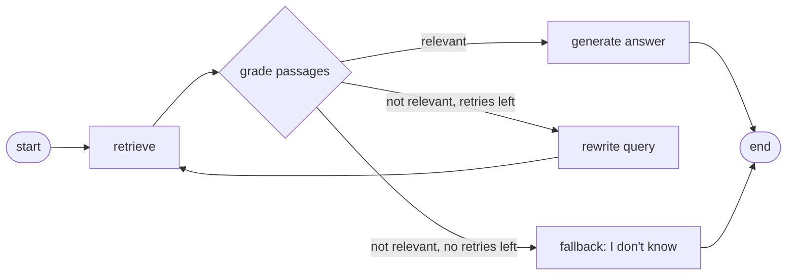

# Multimodal Knowledge Copilot

[](https://github.com/Sushmitha2707/multimodal-rag-copilot/actions)
[](https://huggingface.co/Sushmitha2707/minilm-fastapi-docs-retrieval)

A retrieval-augmented generation (RAG) copilot that answers questions over **PDFs, text, images and audio** and cites
its sources. The repo covers the whole loop: ingestion, vector search, grounded generation, **embedding fine-tuning**,
an optional **LangGraph corrective-RAG mode**, evaluation and user feedback collection.

## Results

### Embedding fine-tuning

`sentence-transformers/all-MiniLM-L6-v2` was fine-tuned (PyTorch, `MultipleNegativesRankingLoss`, 3 epochs) on
743 LLM-generated query-passage pairs built from the FastAPI tutorial docs. Evaluation uses **held-out documents** that
were never seen in training: 256 synthetic queries searched over 64 passages.

| Model | Recall@1 | Recall@3 | Recall@5 | MRR@10 |
|---|---|---|---|---|
| all-MiniLM-L6-v2 (base) | 0.566 | 0.789 | 0.863 | 0.695 |
| **Fine-tuned** | **0.730** | **0.906** | **0.965** | **0.831** |

Fine-tuned model: [Sushmitha2707/minilm-fastapi-docs-retrieval](https://huggingface.co/Sushmitha2707/minilm-fastapi-docs-retrieval)

### End-to-end RAG evaluation

17 hand-written questions over the 4 sample documents in `data/sample_docs` (one question is deliberately out of scope
and should be answered with "I don't know"). Both answering modes were run with Gemini 3.5 Flash Lite as the generator
and the judge.

| Answering mode | Gold-keyword matches | Faithfulness (1-5) | Relevance (1-5) | Mean latency |
|---|---|---|---|---|
| Simple (retrieve, then generate) | 17 / 17 | 5.00 | 5.00 | 2.80 s |
| LangGraph corrective RAG | 17 / 17 | 5.00 | 5.00 | 3.12 s |

**Read these numbers with care.**
- The two modes score identically, so this test set shows **no quality gain** from the graph. It adds about 0.3 s
  (roughly 12%) of mean latency from one extra grading call per question.
- The set is small and easy: the corpus is only 8 chunks, and the simple pipeline already answers the out-of-scope
  question correctly. The set cannot show what the graph is built for, which is catching retrieval misses on harder
  questions. A harder test set is future work.
- The judge is the same model that wrote the answers (models grade themselves generously), and each figure comes from
  a single run, so small latency differences are within noise.

This is a sanity check that the pipeline works end to end, not a benchmark.

## How it works

```
 files ──► ingest ───────────────► chunk ──► embed (HF / fine-tuned) ──► vector DB (FAISS | Pinecone)
          PDF: pypdf                                                         │
          image: BLIP caption (+ OCR)                                        ▼
          audio/video: Whisper (+ffmpeg)    question ──► retrieve top-k ──► LangChain prompt
                                                                              │
                                      Gemini | OpenAI | Anthropic  ◄──────────┘
                                                  │
                          cited answer ──► FastAPI ──► Streamlit chat UI ──► thumbs up/down + correction
                                                                              │
                                                   SQLite feedback ──► preference pairs ──► DPO (LoRA)
```

An optional LangGraph mode (below) grades the retrieved passages before generating the answer.

## Features

- **Multimodal ingestion** with page and timestamp citations: PDF, text, images (BLIP captions, optional Tesseract OCR),
  audio and video (Whisper through ffmpeg).
- **Two vector stores** behind one interface: FAISS (local) and Pinecone (hosted).
- **Grounded answers**: LangChain prompt that restricts answers to the retrieved passages, cites them as `[1]`, `[2]`,
  and falls back to "I don't know based on the provided documents."
- **LangGraph corrective RAG (optional mode)**: grades the retrieved passages, rewrites the query and retries, or
  falls back to "I don't know".
- **Provider-switchable LLM layer**: Gemini, OpenAI and Anthropic adapters (only Gemini has been tested end to end).
- **Embedding fine-tuning and evaluation**: synthetic pair generation with a leak-free split by source document,
  Recall@k / MRR comparison of base vs fine-tuned models.
- **RAG evaluation**: keyword accuracy, LLM-judged faithfulness and relevance, latency, for both answering modes.
- **Feedback loop**: thumbs up/down with an optional corrected answer, stored in SQLite and convertible to preference
  pairs. A LoRA + DPO training script with a plain-PyTorch loss is included.
- **Service and UI**: FastAPI backend (optional API key) and a Streamlit chat app.
- **Engineering**: pytest unit tests, ruff, GitHub Actions CI, Dockerfile.

## Quickstart

Requires Python 3.10-3.12 and a Gemini API key from [Google AI Studio](https://aistudio.google.com/apikey).
`ffmpeg` is needed for audio and video; Tesseract is optional (text inside images).

```powershell
python -m venv .venv
.venv\Scripts\activate                 # macOS/Linux: source .venv/bin/activate
pip install -r requirements.txt
copy .env.example .env                 # macOS/Linux: cp .env.example .env
# edit .env and set GOOGLE_API_KEY (never commit .env)

python -m scripts.ingest_dir data/sample_docs     # index the 4 sample documents
uvicorn copilot.api:app --reload                  # terminal 1: API on :8000
streamlit run app.py                              # terminal 2: chat UI on :8501
```

Try: *"How many vacation days do I get each year?"* (24) and *"What is the capital of France?"* (should answer that it
doesn't know). Then upload your own PDF, image or audio file from the sidebar.

## Reproduce the experiments

```powershell
# 1. A corpus of 30+ documents (here: FastAPI tutorial docs, MIT licensed)
git clone --depth 1 https://github.com/fastapi/fastapi.git ..\fastapi-src
mkdir data\my_corpus
Copy-Item ..\fastapi-src\docs\en\docs\tutorial\*.md data\my_corpus\

# 2. Generate query-passage pairs (split by source file into train / held-out)
python -m scripts.make_pairs --corpus data/my_corpus --provider gemini --max-chunks 250 --questions-per-chunk 4 --sleep 5

# 3. Fine-tune, then compare base vs fine-tuned on the held-out documents
python -m scripts.train_embeddings --pairs data/pairs/train.jsonl --out models/embedding-ft --epochs 3
python -m scripts.eval_retrieval --pairs data/pairs/heldout.jsonl --models sentence-transformers/all-MiniLM-L6-v2 models/embedding-ft

# 4. Publish the model to the Hugging Face Hub (after `hf auth login`)
python -m scripts.push_to_hub --repo-id YOUR-USERNAME/minilm-fastapi-docs-retrieval

# 5. RAG evaluation on a clean index (sample docs only), simple mode and LangGraph mode
$env:INDEX_DIR="data/index_sample"
python -m scripts.ingest_dir data/sample_docs
python -m scripts.eval_rag --providers gemini --judge-provider gemini --sleep 4
python -m scripts.eval_rag --providers gemini --judge-provider gemini --sleep 6 --mode graph --out results/rag_eval_graph.json
Remove-Item Env:INDEX_DIR
```

Optional: Pinecone (`PINECONE_API_KEY` in `.env`, then `python -m scripts.ingest_dir data/sample_docs --backend pinecone`),
and DPO preference tuning (`pip install -r requirements-dpo.txt`, `python -m scripts.train_dpo`).

## LangGraph corrective RAG (optional answering mode)

Besides the simple retrieve-then-generate pipeline, the copilot has a [LangGraph](https://langchain-ai.github.io/langgraph/)
workflow (`copilot/graph.py`) that checks the retrieved passages before answering:



- **Grade:** an LLM call decides whether the passages can answer the question.
- **Rewrite and retry:** if not, the question is rewritten into a better search query and retrieval runs once more.
- **Fallback:** if the second attempt also fails, the copilot says it doesn't know instead of answering from weak context.
- **Cost:** an answerable question needs one extra LLM call (the grade). An unanswerable question takes three calls
  (grade, rewrite, grade) and two retrievals, with no answer generated.

Use it from the chat UI ("Answering mode: graph"), the API (`{"mode": "graph"}` in `/ask`), or the evaluation script:

```powershell
python -m scripts.eval_rag --providers gemini --sleep 6 --mode graph --out results/rag_eval_graph.json
```

The graph logic is unit-tested with a fake retriever and fake LLM (`tests/test_graph.py`). The measured comparison with
the simple pipeline is in the Results section above.

## Project structure

```
copilot/            api.py, rag.py, graph.py, ingest.py, vectorstore.py, embeddings.py, llm.py, prompts.py,
                    feedback.py, metrics.py, dpo.py, config.py
scripts/            ingest_dir, make_pairs, train_embeddings, eval_retrieval, eval_rag,
                    push_to_hub, train_dpo
tests/              pytest unit tests (metrics, parsing, feedback, API, LangGraph workflow, DPO loss)
eval/qa_set.jsonl   17-question end-to-end evaluation set
data/sample_docs/   4 small sample documents
app.py              Streamlit chat UI
Dockerfile, .github/workflows/ci.yml
```

## Limitations

- The fine-tuning gain is measured on **LLM-generated queries** over the **same documentation domain** with a small
  evaluation pool (64 passages) and a single run. It does not show that the model generalizes to other domains or to
  real user queries.
- The RAG evaluation is small and self-judged (see above). It shows no measurable difference between the simple and
  LangGraph modes; the graph's benefit on harder questions has not been tested.
- Only the Gemini provider was tested end to end; the OpenAI and Anthropic adapters are untested.
- Pinecone was tested with the sample documents only, with no performance comparison against FAISS.
- Image support captions the picture; reading text inside images needs Tesseract. Scanned PDFs without a text layer
  are skipped. Video support (audio track) is implemented but untested.
- The DPO pipeline is implemented and its loss is unit-tested, but it has not been trained on real feedback at scale.
  It is lightweight preference optimization, not full RLHF.
- The Dockerfile is provided, but this project has not been deployed to a cloud service.
- The API has no authentication unless `API_KEY` is set. Do not expose `/ingest` publicly without it.

## Troubleshooting

| Problem | Fix |
|---|---|
| `API key required` | `.env` is missing or unsaved. Create it with `copy .env.example .env`, add the key, restart uvicorn |
| `model not found` | Model names change. Set `GEMINI_MODEL` in `.env` to a current model from Google AI Studio |
| `429 RESOURCE_EXHAUSTED` | Free-tier quotas are per model and per day. Use a model with a higher daily limit or wait for the reset |
| Hugging Face upload `502` | Retry, or run `$env:HF_HUB_DISABLE_XET="1"` before the upload command |
| Audio or video fails | Install `ffmpeg` and open a new terminal |

## Tech stack

Python, PyTorch, Hugging Face (Transformers, Sentence-Transformers), LangChain, LangGraph, FAISS, Pinecone, FastAPI,
Streamlit, Whisper, BLIP, Gemini API, SQLite, Docker, pytest, ruff, GitHub Actions.